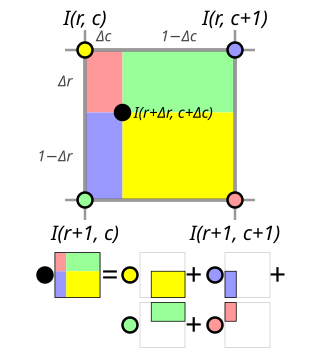
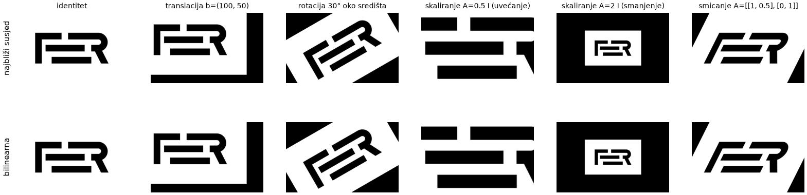
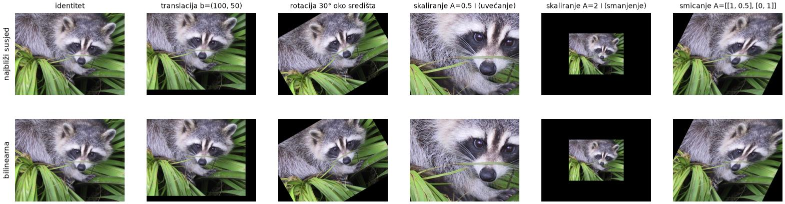
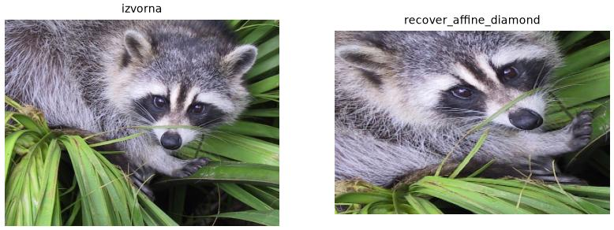
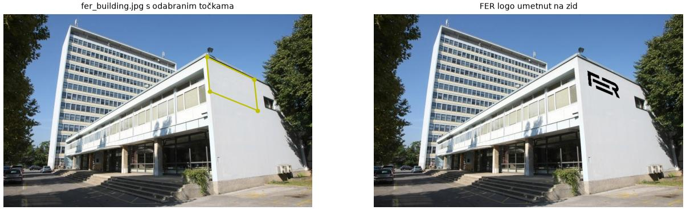
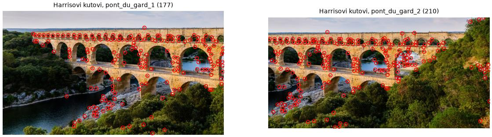
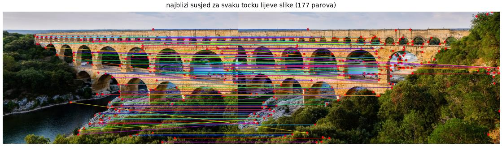
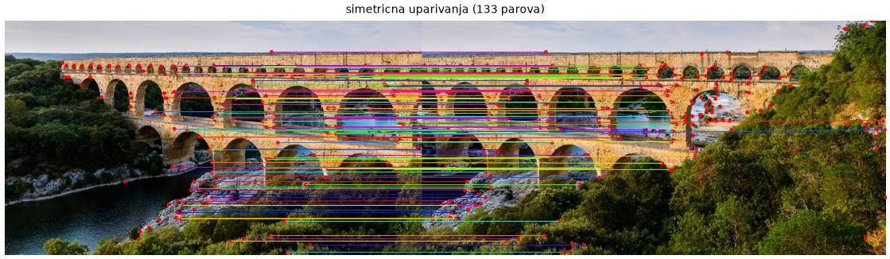
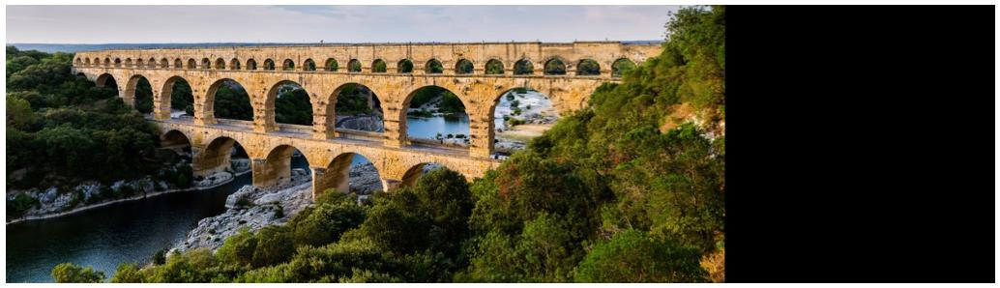

# Druga laboratorijska vježba: geometrijske transformacije, detekcija kutova i uparivanje slika

U računalnom vidu često trebamo
dovesti dvije slike u geometrijski odnos:
ispraviti perspektivu snimljenog dokumenta,
poravnati dvije snimke iste scene
ili više snimaka spojiti u panoramu.
U ovoj vježbi najprije ćemo naučiti
kako sliku geometrijski deformirati
afinim i projekcijskim transformacijama
te kako parametre tih transformacija
odrediti iz poznatih korespondencija.
Zatim ćemo implementirati Harrisov detektor kutova
([članak](http://www.bmva.org/bmvc/1988/avc-88-023.pdf),
[wiki](https://en.wikipedia.org/wiki/Harris_corner_detector))
kojim ćemo korespondencije između dviju slika
pronaći automatski.
Na kraju ćemo iz automatski pronađenih korespondencija
procijeniti projekcijsku transformaciju
i dvije fotografije spojiti u jednostavnu panoramu.

Kao i u prvoj vježbi koristimo biblioteke
NumPy, SciPy, Pillow i Matplotlib. Nije dozvoljeno koristiti gotove implementacije funkcija i algoritama iz OpenCV-a, a koji su predmet ove vježbe. Iznimka je projekcijska deformacija slike, za koju koristimo funkciju `cv2.warpPerspective`.

Podsjetimo se konvencije iz prve vježbe:
polje slike indeksiramo kao `img[r, c]` (redak, stupac),
a geometrijske koordinate točke pišemo kao
$$\mathbf{q} = (x, y)$$, gdje je os $$x$$ horizontalna i raste prema desno (x odgovara indeksu stupca), a os $$y$$ vertikalna i raste prema dolje (y odgovara indeksu retka).
Točke ćemo u kodu pohranjivati u polja oblika `(N, 2)`
s koordinatama `(x, y)` u svakom retku.

Ispitne slike:
slika rakuna iz paketa `scipy.datasets` te
slike `fer_logo.jpg`, `house.jpg`, `fer_building.jpg`
i par fotografija akvadukta Pont du Gard:


<br/><em>Slika 1. Ispitne slike `fer_logo.jpg`, `house.jpg` i `fer_building.jpg`.</em>

<div style="display: flex; gap: 8px; max-width: 640px;">
  
  
</div>

<em>Slika 2. Fotografije akvadukta Pont du Gard (`pont_du_gard_1.jpg` i `pont_du_gard_2.jpg`).</em>

[fer_logo.jpg](../assets/images/lab2/fer_logo.jpg),
[house.jpg](../assets/images/lab2/house.jpg),
[fer_building.jpg](../assets/images/lab2/fer_building.jpg),
[pont_du_gard_1.jpg](../assets/images/lab2/pont_du_gard_1.jpg),
[pont_du_gard_2.jpg](../assets/images/lab2/pont_du_gard_2.jpg)
(fotografije akvadukta preuzete su iz repozitorija
[opencv_extra](https://github.com/opencv/opencv_extra/tree/4.x/testdata/stitching),
licenca Apache 2.0, i umanjene dva puta).

## Zadatak 1: afine transformacije i interpolacija

### Unatražne deformacije slika

U računalnom vidu često trebamo modificirati slike
različitim geometrijskim deformacijama
kao što su uvećanje, rotiranje ili izrezivanje.
Razmatrat ćemo _unatražne_ deformacije
koje se najčešće koriste u praksi.
Označimo ulaznu (izvorišnu) sliku s $$I_s$$,
izlaznu (odredišnu) sliku s $$I_d$$,
vektor cjelobrojnih pikselskih koordinata s $$\mathbf{q}$$
te parametriziranu koordinatnu
transformaciju s $$\mathbf{T}_p$$.
Tada unatražnu deformaciju slike
možemo formulirati sljedećim izrazom:

$$I_d (\mathbf{q}) = I_s (\mathbf{T}_p(\mathbf{q})) \ .$$

Drugim riječima, za svaki piksel _odredišne_ slike
izračunamo odakle u _izvorišnoj_ slici
treba pročitati vrijednost.
Zato transformacija $$\mathbf{T}_p$$
preslikava odredišne u izvorišne koordinate.
Prednost unatražnog pristupa je što
svaki odredišni piksel dobiva točno jednu vrijednost,
pa u rezultatu nema rupa.

Kako slike tipično imaju dvije geometrijske osi,
i domena i kodomena koordinatnih transformacija
odgovarat će Euklidskoj ravnini:
$$\mathbf{T}_p : \mathbb{R}^2 \rightarrow \mathbb{R}^2$$.
U praksi se koriste različite
vrste geometrijskih transformacija,
ali najčešće koristimo
afine, projekcijske i radijalne transformacije.
Afine i projekcijske transformacije
čuvaju kolinearnost točaka,
dok radijalne transformacije ne utječu na
udaljenost od ishodišta koordinatnog sustava.

### Afine transformacije

Označimo početni 2D vektor realnih koordinata s $$\mathbf{q}_s$$,
konačni 2D vektor realnih koordinata s $$\mathbf{q}_d$$,
linearno ravninsko preslikavanje s $$\mathbf{A}$$,
te 2D pomak s $$\mathbf{b}$$.
Tada afinu transformaciju ravnine
možemo prikazati sljedećom jednadžbom:

$$\mathbf{q}_s = \mathbf{T}_p(\mathbf{q}_d) = \mathbf{A} \cdot \mathbf{q}_d + \mathbf{b} \ .$$

Tablica prikazuje hijerarhijski popis
vrsta afinih transformacija
tako da svaka sljedeća vrsta
odgovara poopćenju prethodne
($$\mathbf{I}$$=$$\mathrm{diag}(1,1)$$,
 $$\mathbf{R}$$ je matrica rotacije 2D podataka):

| *transformacija*                | *stupnjevi slobode* | *invarijante* | *ograničenja* |
| ----------------                | ------------------- | ------------- | --------- |
| translacija                     |           2         | orijentacija  | $$\mathbf{A}=\mathbf{I}$$ |
| transformacija krutog tijela    |           3         | udaljenost    | $$\mathbf{A}=\mathbf{R}$$, $$\mathbf{R}^\top\mathbf{R}=\mathbf{I}$$ |
| sličnost                        |           4         | kutovi        | $$\mathbf{A}=s\mathbf{R}$$, $$\mathbf{R}^\top\mathbf{R}=\mathbf{I}$$ |
| općenita afina transformacija   |           6         | paralelnost   | nema |

Ako se odnos između dvije slike
može opisati afinom deformacijom,
onda parametre koordinatne transformacije
možemo izlučiti iz korespondencija.
Neka su u izvorišnoj slici
$$I_s$$
zadane točke
$$\mathbf{q}_{si} = (x_{si}, y_{si})$$.
Neka su u odredišnoj slici
$$I_d$$
zadane korespondentne točke
$$\mathbf{q}_{di} = (x_{di}, y_{di})$$.
Tada za svaki par korespondencija vrijedi:

$$\eqalign{
x_{si} &= a_{11} x_{di} + a_{12} y_{di} + b_1\\
y_{si} &= a_{21} x_{di} + a_{22} y_{di} + b_2}
$$

Ove dvije jednadžbe možemo presložiti
tako da 6 parametara afine transformacije
istaknemo kao nepoznanice
te ih zapisati u matričnom obliku kako slijedi:

$$
\left\lbrack \matrix{x_{si} \cr y_{si}} \right\rbrack =
  \left\lbrack \matrix{x_{di} & y_{di} & 0 & 0 & 1 & 0\cr 0 & 0 & x_{di} & y_{di} & 0 & 1} \right\rbrack
  \cdot
  \left\lbrack \matrix{a_{11} \cr a_{12} \cr a_{21} \cr a_{22} \cr b_{1} \cr b_{2}} \right\rbrack
$$

Ako dodamo još dvije korespondencije, dobit ćemo sustav $$6\times 6$$
koji ima jedinstveno rješenje, osim ako su korespondencije kolinearne.
Tražena deformacija bit će određena rješenjem tog sustava.

### Interpolacija slike u realnim koordinatama

Primijetimo da koordinatna transformacija nije diskretna,
tj. da 2D vektor $$\mathbf{T}_p(\mathbf{q})$$ ima realne koordinate.
To znači da u odredišni piksel $$\mathbf{q}$$ valja upisati
element izvorne slike koji se nalazi "između" njenih piksela.
Aproksimativno uzorkovanje diskretnih slika u realnim koordinatama
nazivamo interpolacijom.
Postoji više interpolacijskih pristupa,
a ovdje ćemo upoznati interpolaciju najbližim susjedom
i bilinearnu interpolaciju.

**Interpolacija najbližim susjedom**
naprosto preuzima vrijednost najbližeg piksela.
Koordinate najbližeg piksela dobivamo
zaokruživanjem realnih koordinata
na najbliže cjelobrojne vrijednosti:

$$I_{NN}(r+\Delta r, c+\Delta c) = I(\lfloor r+\Delta r+0.5 \rfloor, \lfloor c+\Delta c+0.5 \rfloor )$$

**Bilinearna interpolacija** pretpostavlja
da elementi slike na realnim koordinatama
linearno ovise o udaljenosti od poznatih diskretnih piksela.
Slika ispod pokazuje da interpolirani slikovni element
dobivamo kao linearnu kombinaciju susjedna četiri piksela,
pri čemu veću težinu dobivaju pikseli
koji su bliži realnim koordinatama.
Težina svakog piksela jednaka je površini pravokutnika
nasuprot njemu, koji je obojen istom bojom kao i piksel.


<br/><em>Slika 3. Bilinearna interpolacija: vrijednost u crnoj točki zbroj je vrijednosti četiriju piksela pomnoženih površinama nasuprotnih pravokutnika iste boje. [Izvor](
https://commons.wikimedia.org/wiki/File:Bilinear_interpolation_visualisation.svg).</em>


Prikazani odnosi matematički se mogu prikazati sljedećom jednadžbom:

$$\begin{aligned}
I_{BL}(r+\Delta r, c+\Delta c)
  &= \colorbox{#FFFF00}{$I(r,c)     \cdot (1-\Delta r)(1-\Delta c)$} \\
  &+ \colorbox{#9999FF}{$I(r,c+1)   \cdot (1-\Delta r)\,\Delta c$} \\
  &+ \colorbox{#99FF99}{$I(r+1,c)   \cdot \Delta r\,(1-\Delta c)$} \\
  &+ \colorbox{#FF9999}{$I(r+1,c+1) \cdot \Delta r\,\Delta c$} \ .
\end{aligned}$$

Napominjemo da bi se ista jednadžba dobila
i kad bismo zrcalili vertikalnu koordinatu
odnosno kad bi indeksi redaka rasli prema gore.
Za usporedbu, interpolacija najbližim susjedom
bila bi jednaka gornjem lijevom pikselu $$I(r,c)$$
jer je on najbliži zadanim realnim koordinatama.
Takvo stanje stvari odražava i činjenica
da je žuti pravokutnik veći
i od plavog i od zelenog i od crvenog pravokutnika.

Detaljniji prikaz bilinearne interpolacije
kao i recept za učinkovitu implementaciju
mogu se pronaći u završnom radu
[Petre Bosilj](http://www.zemris.fer.hr/~ssegvic/project/pubs/bosilj10bs.pdf).

**a) Afine transformacije i interpolacija.**
Napišite funkciju `transform_affine(Is, A, b, Hd, Wd, interpolation="nearest")`
koja izvorišnu sliku `Is` deformira
u skladu s parametrima `A` i `b`
te vraća odredišnu sliku rezolucije `Hd`$$\times$$`Wd`.
Argument `interpolation` određuje način interpolacije
i može biti `"nearest"` (najbliži susjed) ili `"bilinear"` (bilinearna interpolacija).
Funkcija treba raditi i za sive slike i za slike u boji.
Uputa: prođite petljama kroz sve odredišne piksele $$(r, c)$$, za svaki izračunajte izvorišne koordinate $$\mathbf{q}_s = \mathbf{A} \cdot \mathbf{q}_d + \mathbf{b}$$, pri čemu je $$\mathbf{q}_d = (x, y) = (c, r)$$. Ovisno o vrsti interpolacije izračunajte intenzitet piksela i zapišite ga u odredišnu sliku. Pikseli koji padaju izvan izvorišne slike trebaju biti crni.

Funkciju ispitajte na slici FER loga koju po potrebi pretvorite u sivu sliku i na slici rakuna koja odgovara slici u boji.
Neka odredišna rezolucija bude jednaka rezoluciji izvorišne slike. Za obje interpolacije isprobajte sljedeće transformacije:
identitet, translacija za $$\mathbf{b} = (100, 50)$$,
rotacija za $$30^{\circ}$$ oko središta slike,
skaliranje s $$\mathbf{A} = 0.5\,\mathbf{I}$$ i $$\mathbf{A} = 2\,\mathbf{I}$$
te smicanje s $$\mathbf{A} = \left\lbrack \matrix{1 & 0.5 \cr 0 & 1} \right\rbrack$$.
Za rotaciju i skaliranje vektor $$\mathbf{b}$$
odredite tako da se središte odredišne slike
preslika u središte izvorišne slike.
U kojem smjeru se slika pomiče
pri translaciji za pozitivan $$\mathbf{b}$$?
Zašto $$\mathbf{A} = 0.5\,\mathbf{I}$$ sliku _uvećava_?
Koja od invarijanti iz tablice se ne čuva
pri smicanju? Kako se očituje razlika između razmatranih interpolacija?

Primjer:


<br/><em>Slika 4. Osnovne afine transformacije slike FER loga interpolacijom najbližim susjedom (gore) i bilinearnom interpolacijom (dolje).</em>


<br/><em>Slika 5. Osnovne afine transformacije slike rakuna interpolacijom najbližim susjedom (gore) i bilinearnom interpolacijom (dolje).</em>

**b) Procjena afine transformacije iz korespondencija.**
Napišite funkciju `recover_affine(Qs, Qd)`
koja iz tri para korespondencija
(polja oblika `(3, 2)` s koordinatama $$(x, y)$$)
vraća parametre `A` i `b` afine transformacije
koja odredišne točke preslikava u izvorišne.
Za rješavanje sustava jednadžbi koristite `np.linalg.solve`.
Pomoću nje napišite funkciju
`recover_affine_diamond(Hs, Ws, Hd, Wd)`
koja vraća parametre afine transformacije
koja piksele _središta stranica_ izvorišne slike
dimenzija Hs$$\times$$Ws
preslikava u _kuteve_ odredišne slike dimenzija Hd$$\times$$Wd.
Ispitajte parametre provođenjem deformacije
funkcijom `transform_affine` uz bilinearnu interpolaciju.
Slika prikazuje ulaz i izlaz
ako za izvorišnu sliku odaberemo sliku rakuna:


<br/><em>Slika 6. Izvorišna slika i željeni izlaz za zadatak 1b.</em>

## Zadatak 2: projekcijske transformacije

Projekcijske transformacije ravnine
možemo prikazati sljedećom jednadžbom:

$$\mathbf{q}_s = \mathbf{T}_p(\mathbf{q}_d) =
  \frac{\mathbf{A} \cdot \mathbf{q}_d + \mathbf{b}}
       {\mathbf{w}^\top\mathbf{q}_d + w_0} \ .$$

Primijetite da je brojnik jednadžbe vektor, a nazivnik skalar.
Matrica $$\mathbf{A}$$,
vektori $$\mathbf{b}$$ i $$\mathbf{w}$$
te skalar $$w_0$$ su parametri projekcijske transformacije.
Isto preslikavanje možemo zapisati i kompaktnije,
kao linearnu transformaciju _homogenih koordinata_.
Homogene koordinate točke $$(x, y)$$ dobivamo
dodavanjem treće koordinate jednake jedan.
Tada vrijedi:

$$
\left\lbrack \matrix{x_s' \cr y_s' \cr w_s'} \right\rbrack =
\mathbf{H} \left\lbrack \matrix{x_d \cr y_d \cr 1} \right\rbrack =
\left\lbrack \matrix{\mathbf{A} & \mathbf{b} \cr \mathbf{w}^\top & w_0} \right\rbrack
\left\lbrack \matrix{x_d \cr y_d \cr 1} \right\rbrack, \qquad
x_s = \frac{x_s'}{w_s'}, \quad y_s = \frac{y_s'}{w_s'} \ .
$$

Matricu $$\mathbf{H}$$ veličine $$3\times3$$ nazivamo _homografijom_.
Množenje matrice $$\mathbf{H}$$ skalarom $$\lambda \neq 0$$
ne mijenja preslikavanje,
pa homografija ima samo osam stupnjeva slobode.

Parametre projekcijske transformacije
možemo odrediti iz korespondencija
na vrlo sličan način kao i za afine transformacije.
Međutim, u ovom slučaju svaka korespondencija
doprinosi dva _homogena_ linearna ograničenja
nad parametrima transformacije, do kojih dolazimo
prebacivanjem nazivnika na lijevu stranu jednadžbe.
To možemo napraviti kad god su korespondencije konačne
jer je tada nazivnik sigurno različit od nule.
Ako prikupimo $$n$$ korespondencija,
dobit ćemo homogeni linearni sustav
s $$2n$$ jednadžbi i devet nepoznanica oblika
$$\mathbf{M}\mathbf{h}=\mathbf{0}$$,
gdje vektor $$\mathbf{h}$$ sadrži elemente matrice $$\mathbf{H}$$
poredane po retcima.
Za jednu korespondenciju
$$(\mathbf{q}_s, \mathbf{q}_d) = ((x_s, y_s), (x_d, y_d))$$
dva retka matrice $$\mathbf{M}$$ glase:

$$
\left\lbrack \matrix{
  x_d & y_d & 1 & 0 & 0 & 0 & -x_s x_d & -x_s y_d & -x_s \cr
  0 & 0 & 0 & x_d & y_d & 1 & -y_s x_d & -y_s y_d & -y_s
} \right\rbrack \ .
$$

Za vježbu izvedite te retke iz gornje jednadžbe!

S obzirom na to da su naše jednadžbe homogene,
parametre projekcijske transformacije možemo odrediti
samo do proizvoljne multiplikativne konstante.
Stoga ne čudi da će sustav $$\mathbf{M}$$
imati točno jedno netrivijalno rješenje
i ako prikupimo samo četiri korespondencije,
pod pretpostavkom da niti jedna trojka korespondencija nije kolinearna.
Rješenje sustava odgovara
[desnom singularnom vektoru](https://en.wikipedia.org/wiki/Singular_value_decomposition#Solving_homogeneous_linear_equations)
matrice $$\mathbf{M}$$
koji odgovara singularnoj vrijednosti nula.
Ako imamo višak ograničenja (više od 4 korespondencije)
optimalno rješenje u algebarskom smislu
dobivamo kao desni singularni vektor
koji odgovara najmanjoj singularnoj vrijednosti matrice $$\mathbf{M}$$.

**a) Procjena homografije iz korespondencija.**
Napišite funkciju `recover_projective(Qs, Qd)`
koja vraća matricu homografije $$\mathbf{H}$$
ako su zadane točke izvorišne slike `Qs`
i korespondentne točke odredišne slike `Qd`
(polja oblika `(N, 2)`, $$N \geq 4$$).
Upute:
- složite matricu $$\mathbf{M}$$ prema gornjem izrazu
- za rješavanje homogenog sustava koristite `np.linalg.svd`;
- vektor rješenja preoblikujte u matricu $$3\times3$$
  (`np.reshape`) i podijelite s elementom $$h_{33}$$
  kako bi rezultat bio jedinstven.


**b) Projekcijska deformacija slike.**
Unatražnu projekcijsku deformaciju
nećemo implementirati sami,
nego ćemo koristiti funkciju
[cv2.warpPerspective](https://docs.opencv.org/4.x/da/d54/group__imgproc__transform.html#gaf73673a7e8e18ec6963e3774e6a94b87).
Ona za svaki odredišni piksel izračunava izvorišne koordinate
na isti način kao naša funkcija `transform_affine`:
koordinate odredišnog piksela proširi u homogene,
pomnoži ih matricom $$\mathbf{H}$$,
podijeli s trećom koordinatom
te interpolira izvorišnu sliku.
Pripazite na dvije pojedinosti. Naša homografija preslikava odredišne točke u izvorišne, a `cv2.warpPerspective` po zadanom očekuje obrnuto. Stoga je potrebno predati zastavicu `cv2.WARP_INVERSE_MAP`. Veličina odredišne slike zadaje se kao `(Wd, Hd)`.

Homografija opisuje preslikavanje između dviju ravnina,
pa je možemo iskoristiti i za umetanje digitalnih slika
na ravne površine u stvarnoj fotografiji, poput zida, plakata ili zaslona.
Projekcijsku deformaciju iskoristit ćemo za umetanje FER loga
na desni zid zgrade B (`fer_building.jpg`).
Na zidu smo odabrali četiri točke
(gornji lijevi, gornji desni, donji desni i donji lijevi kut):

```python
Qd = np.array([[526, 111], [649, 169], [658, 250], [534, 200]], float)
```

Za izvorišne točke uzmite odgovarajuće kutove slike loga
te funkcijom `recover_projective` procijenite homografiju
koja točke na zidu preslikava u točke loga.
Logo zatim umetnite sljedećom funkcijom,
koja deformira logo funkcijom `cv2.warpPerspective`
i u fotografiju upisuje samo njegove tamne piksele:

```python
def paste_logo(img, logo, H, threshold=128):
    h, w = img.shape[:2]
    warped = cv2.warpPerspective(logo.astype(float), H, (w, h),
                                 flags=cv2.INTER_LINEAR | cv2.WARP_INVERSE_MAP,
                                 borderMode=cv2.BORDER_CONSTANT, borderValue=255)
    dark = warped < threshold
    out = img.copy()
    out[dark] = warped[dark][:, None] if img.ndim == 3 else warped[dark]
    return out
```

Primjer:


<br/><em>Slika 7. Fotografija zgrade FER-a s odabranim točkama na zidu i rezultat umetanja FER loga.</em>

## Zadatak 3: Harrisov detektor kutova

U dosadašnjim zadacima korespondencije među slikama zadavali smo ručno.
Često ih, međutim, želimo odrediti automatski,
primjerice kad dvije fotografije iste scene želimo spojiti u panoramu.
Prvi korak takvog postupka je detekcija _značajki_,
odnosno istaknutih dijelova slike
koje možemo pouzdano pronaći i u drugoj slici iste scene.
Detekcija značajki osnova je i za mnoge druge probleme računalnog vida,
poput praćenja i slikovnog pretraživanja.
Dobri kandidati za značajke su kutovi objekata u sceni:
u okolini kuta intenzitet se mijenja u dva smjera,
pa se položaj kuta može precizno odrediti.
Kutove ćemo detektirati Harrisovim algoritmom,
čijoj implementaciji pristupamo kroz niz koraka.
Algoritam ćemo testirati na slikama
`fer_logo.jpg` i `house.jpg`
(sive, tipa `float`),
a na kraju ga primijeniti i na fotografije akvadukta.

**a) Harrisov odziv.**
Napišite funkciju `harris_response(img, sigma, k, win)`
koja za sivu sliku vraća Harrisov odziv u svakom pikselu.
Postupak se sastoji od sljedećih koraka:

1. Sliku zagladite Gaussovim filtrom
   i izračunajte gradijente $$I_x$$ i $$I_y$$ kao u prvoj vježbi.
2. U svakom pikselu izračunajte $$I_x^2$$, $$I_x I_y$$ te $$I_y^2$$ (to nisu druge derivacije!).
3. U svakom pikselu $$\mathbf{q}$$ izračunajte karakterističnu matricu $$\mathbf{G}$$:

   $$
     \mathbf{G}(\mathbf{q})=
       \left\lbrack \matrix{
        \sum_W I_x^2   & \sum_W I_x I_y \cr
        \sum_W I_x I_y & \sum_W I_y^2 } \right\rbrack =
       \left\lbrack \matrix{ a & c \cr c & b } \right\rbrack
   $$

   Elementi matrice nisu vrijednosti momenata u tome pikselu,
   nego sume momenata u njegovom lokalnom susjedstvu $$W$$
   veličine `win`$$\times$$`win` (npr. .
   Takvo sumiranje odgovara konvoluciji s jezgrom jedinica,
   pa sve tri sume možete izračunati funkcijom `ndimage.convolve`.
4. Izračunajte Harrisov odziv
   kao razliku determinante matrice
   i kvadriranog traga pomnoženog konstantom $$k$$
   (tipično $$k = 0.04$$ do $$0.06$$):

   $$r(\mathbf{q}) = ab - c^2 - k(a+b)^2 \ .$$

Determinanta je jednaka umnošku svojstvenih vrijednosti $$\lambda_1 \lambda_2$$,
a trag njihovom zbroju $$\lambda_1 + \lambda_2$$.
Odziv je velik samo ako su _obje_ svojstvene vrijednosti velike,
tj. ako se intenzitet u susjedstvu mijenja u dva smjera.
Prikažite Harrisov odziv kao sliku.
Kakav je odziv na rubovima, a kakav na jednolikim područjima?

Primjer Harrisovih odziva:


<br/><em>Slika 8. Harrisov odziv za sliku FER loga.</em>

**b) Potiskivanje nemaksimalnih odziva.**
U ovome koraku cilj je potisnuti odzive
koji bi mogli uzrokovati lažno pozitivne detekcije.
Prvo ćemo sve odzive koji su manji od praga
postaviti na nulu.
Prag zadajemo relativno prema najjačem odzivu u slici,
kao $$\mathrm{thr} \cdot \max_{\mathbf{q}} r(\mathbf{q})$$
(tipično $$\mathrm{thr} = 0.01$$).
Tako prag ne ovisi o rasponu intenziteta slike.
U drugom koraku ćemo potisnuti sve odzive
koji nemaju maksimalnu vrijednost u svome lokalnom susjedstvu.
Veličina lokalnog susjedstva je još jedan parametar algoritma.
Implementirajte opisano potiskivanje nemaksimalnih odziva,
tako da lako možete mijenjati parametre algoritma.

**c) Odabir najvećih odziva.**
Dohvatite koordinate odziva različitih od nule
funkcijom `np.nonzero`
te izdvojite `topk` piksela s najvećim odzivima.
Sve korake objedinite u funkciji
`harris(img, sigma, k, thr, win, nms_size, topk)`
koja vraća polje oblika `(N, 2)`
s koordinatama $$(x, y)$$ detektiranih kutova,
sortiranih po odzivu.
Vizualizirajte rezultat iscrtavajući krugove
u koordinatama detektiranih kutova povrh zadane slike
(uputa: `plt.plot(x, y, "o", mfc="none")`).

Primjer detektiranih Harrisovih kutova:


<br/><em>Slika 9. Harrisovi kutovi na slici FER loga.</em>

Parametri algoritma: sigma=1, thr=0.01, k=0.04, topk=100,
veličina prozora za sumiranje=(5, 5),
veličina prozora za potiskivanje nemaksimalnih odziva=(14, 14).


<br/><em>Slika 10. Harrisovi kutovi na slici kuće.</em>

Parametri algoritma: sigma=1.5, thr=0.01, k=0.04, topk=100,
veličina prozora za sumiranje=(5, 5),
veličina prozora za potiskivanje nemaksimalnih odziva=(14, 14).

Na kraju detektirajte kutove
na sivim inačicama slika `pont_du_gard_1.jpg` i `pont_du_gard_2.jpg`.
Prag i ostale parametre prilagodite tako da
na svakoj slici dobijete otprilike 150 do 250 kutova.
Nalaze li se kutovi na istim dijelovima scene u obje slike?

Primjer
(sigma=1.5, thr=0.08, k=0.04, prozor za sumiranje 5, potiskivanje 10, topk=400):


<br/><em>Slika 11. Harrisovi kutovi na dvjema fotografijama akvadukta.</em>

## Zadatak 4: uparivanje značajki i jednostavna panorama

Harrisov algoritam daje nam lokacije kutova u slici. Međutim, to nije dovoljno za automatsko određivanje korespondencija. Potrebno je još prepoznati koji kutovi u dvjema slikama prikazuju istu točku scene. Za to nam služe opisnici (deskriptori) ključnih točaka. Opisnik možemo zamisliti kao potpis točke u sceni koji je prepoznatljiv iz različitih pogleda. To nam omogućuju da istu točku prepoznamo u više različitih pogleda prema njezinom potpisu. U praksi, opisnici su obično višedimenzionalni vektori koji kodiraju izgled okoline značajke.

Zbog jednostavnosti, izračun opisnika prepustit ćemo biblioteci opencv, a postupak uparivanja ćemo implementirati samostalno. Za izračun opisnika koristit ćemo sljedeću funkciju koja koristi algoritam SIFT o kojem ćemo učiti na predavanjima.
Funkcija za sivu sliku i polje točaka vraća opisnike za svaku zadanu točku
u obliku polja dimenzija `(N, 128)`.
Koordinate točaka predajemo kao polje oblika `(N, 2)`
u kojem svaki redak sadrži koordinate $$(x, y)$$ jedne točke,
pri čemu je $$x$$ indeks stupca, a $$y$$ indeks retka slike,
kao što ih vraća funkcija `harris` iz zadatka 3.

```python
def sift_descriptors(img, points):
    img = np.clip(img, 0, 255).astype(np.uint8)
    keypoints = [cv2.KeyPoint(float(x), float(y), 16) for x, y in points]
    _, descriptors = cv2.SIFT_create().compute(img, keypoints)
    return descriptors.astype(float)
```

**a) Uparivanje najbližim susjedom.**
Detektirajte Harrisove kutove na obje sive slike akvadukta
i izračunajte njihove opisnike.
Napišite funkciju `find_matches_nn(d1, d2)`
koja za svaki opisnik iz `d1`
pronalazi najsličniji opisnik iz `d2`
prema euklidskoj udaljenosti
te vraća polje parova indeksa `(i, j)`.

Za prikaz uparenih točaka koristite sljedeću funkciju,
koja dvije slike prikazuje jednu pored druge
i spaja uparene točke linijama
(`pairs` je polje parova indeksa `(i, j)`: točka `pts1[i]` uparena je s točkom `pts2[j]`):

```python
def display_matches(img1, pts1, img2, pts2, pairs, ax=None, color=None, lw=0.8):
    H = max(img1.shape[0], img2.shape[0])

    def pad(im):
        out = np.zeros((H,) + im.shape[1:], dtype=im.dtype)
        out[:im.shape[0]] = im
        return out

    canvas = np.concatenate([pad(img1), pad(img2)], axis=1)
    off = img1.shape[1]
    if ax is None:
        _, ax = plt.subplots(figsize=(12, 5))
    ax.imshow(canvas, cmap="gray" if canvas.ndim == 2 else None)
    ax.plot(pts1[:, 0], pts1[:, 1], "r.", ms=4)
    ax.plot(pts2[:, 0] + off, pts2[:, 1], "r.", ms=4)
    for i, j in pairs:
        ax.plot([pts1[i, 0], pts2[j, 0] + off], [pts1[i, 1], pts2[j, 1]],
                color=color or plt.cm.hsv(np.random.rand()), lw=lw)
    ax.set_axis_off()
    return ax
```

Primjer:


<br/><em>Slika 12. Najbliži susjed u desnoj slici za svaku točku lijeve slike.</em>

**b) Simetrično uparivanje i test omjera.**
Mnogi parovi iz prethodnog koraka su pogrešni.
Napišite funkciju `find_matches_filtered(d1, d2, ratio)`
koja zadržava samo _simetrične_ parove.
Par $$(i, j)$$ zadržavamo ako je $$j$$ najbliži susjed točke $$i$$
i ujedno $$i$$ najbliži susjed točke $$j$$.
Tako svaka točka lijeve slike
sudjeluje u najviše jednom paru.
Dodatno primijenite _test omjera_:
par zadržavamo samo ako je udaljenost do najbližeg susjeda
manja od `ratio` puta udaljenosti do drugog najbližeg
(tipično `ratio` = 0.8). Dakle, prihvaćamo samo one parove gdje se najbliži susjed ističe i znatno je bliže od prvog sljedećeg susjeda. Napravite opisano filtriranje parova korespondencija na slikama vijadukta i prikažite preostale parove. 

Primjer simetričnih parova (bez testa omjera):


<br/><em>Slika 13. Simetrični parovi bez testa omjera.</em>

**c) Homografija i panorama.**

Procjena homografije iz automatski utvrđenih korespondencija može se koristiti za izradu panoramskih fotografija uz određene pretpostavke.
Homografija dobro opisuje odnos dviju fotografija
ako se kamera između snimki samo zakrenula oko svog središta
ili ako je scena ravna ili vrlo udaljena.
Postupak se sastoji od sljedećih koraka:
detekcije značajki,
izračuna opisnika i uparivanja značajki između slika,
procjene homografije i transformacije jedne slike u ravninu druge.

Napišite funkciju `panorama(img1, img2)`
koja dvije fotografije u boji automatski spaja u panoramu.
Funkcija povezuje sve dosadašnje dijelove vježbe.
Sliku 2 deformirat ćemo u koordinatni sustav slike 1,
pa panoramu gradimo na platnu čiji je koordinatni sustav
jednak koordinatnom sustavu slike 1:
ishodište platna je gornji lijevi kut slike 1,
a slika 2 nadovezuje se na nju s desne strane.
Postupak je sljedeći:

1. Obje slike pretvorite u sive slike tipa `float`
   i na njima detektirajte kutove funkcijom `harris` iz zadatka 3
   (parametre uzmite kao u primjeru za fotografije akvadukta).
2. Kutovima izračunajte opisnike funkcijom `sift_descriptors`.
3. Opisnike uparite funkcijom `find_matches_filtered`
   uz simetrično uparivanje i test omjera.
4. Iz parova izdvojite uparene točke `Qd` (slika 1) i `Qs` (slika 2)
   te procijenite homografiju funkcijom iz zadatka 2:
   `H = recover_projective(Qs, Qd)`.
   Homografija $$\mathbf{H}$$ točke slike 1 preslikava
   u odgovarajuće točke slike 2.
5. Inicijalizirajte prazno (crno) platno.
   Neka je visina platna jednaka visini slike 1 (`h`),
   a širina dvostruko veća od širine slike 1 (`2 * w`),
   kako bi na platno stala i slika 2:
   `pano = np.zeros((h, 2 * w, 3), dtype=np.uint8)`.
6. Sliku 2 deformirajte u koordinatni sustav platna
   funkcijom `cv2.warpPerspective` kao u zadatku 2b:

   ```python
   warped = cv2.warpPerspective(img2, H, (2 * w, h),
                                flags=cv2.INTER_LINEAR | cv2.WARP_INVERSE_MAP)
   ```

   Homografija $$\mathbf{H}$$ svakom pikselu platna,
   odnosno slike 1, pridružuje odgovarajuću točku slike 2,
   što je upravo preslikavanje potrebno za unatražnu deformaciju.
   Pikseli koji padaju izvan slike 2 ostaju crni.
   Funkcija `cv2.warpPerspective` radi i sa slikama u boji: deformira svaki kanal posebno. Deformiranu sliku zatim u cijelosti zalijepite na platno.
7. Na platno zalijepite sliku 1 u lijevi dio platna. U području preklapanja tako ostaje slika 1.
8. Vratite platno kao rezultat.

Funkciju pozovite na fotografijama akvadukta u boji i prikažite panoramu.

Primjer panorame:


<br/><em>Slika 14. Panorama dobivena iz automatski pronađenih korespondencija.</em>
